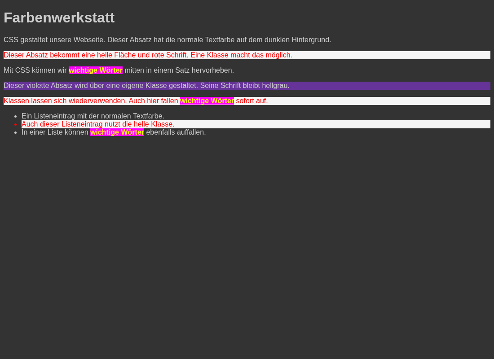

# 1 – Farben und Selektoren

Gestalte eine Farbenwerkstatt. Übe, alle Elemente einer Art auszuwählen und einzelne Stellen mit wiederverwendbaren Klassen hervorzuheben.

## Dein Auftrag

1. Erstelle `index.html` und `style.css` in diesem Ordner. Erzeuge das HTML-Grundgerüst und verknüpfe im `<head>` deine CSS-Datei mit `<link rel="stylesheet" href="style.css">`.
2. Kopiere die Inhalte aus [texte.txt](texte.txt): eine `<h1>`-Überschrift und fünf `<p>`-Absätze. Umschließe in Absatz 3 und 5 jeweils nur die Wörter **wichtige Wörter** mit `<strong>`.
3. Gestalte die gesamte Seite über den Elementselektor `body`: Hintergrund `#333333`, Textfarbe `#cccccc`, Schriftfamilie `Arial, sans-serif`.
4. Vergib dieselbe frei gewählte Klasse an Absatz 2 und 5: Beide bekommen rote Schrift (`red`) auf hellem Hintergrund (`whitesmoke`).
5. Gib Absatz 4 eine andere Klasse und den Hintergrund `rebeccapurple`. Seine Schrift bleibt hellgrau.
6. Gib beiden `<strong>`-Elementen dieselbe weitere Klasse: gelbe Schrift (`yellow`) auf Hintergrund `magenta`. Die Hervorhebung soll nur die beiden Wörter umfassen.
7. Ergänze unter den Absätzen eine Liste mit den drei Einträgen aus `texte.txt`. Verwende beim zweiten Eintrag die bereits vorhandene Klasse für rote Schrift auf hellem Hintergrund. Hebe im dritten Eintrag wieder nur **wichtige Wörter** mit `<strong>` und der vorhandenen Hervorhebungsklasse hervor.
8. Probiere beim zweiten Absatz für die rote Schrift nacheinander `red`, `#ff0000` und `rgb(255, 0, 0)` aus. Die Farbe bleibt gleich. Für das Endergebnis kannst du eine dieser Schreibweisen wählen.

## Neu: Farben als Code

Neben Farbnamen versteht CSS auch Farbcodes. Diese drei Werte stellen zum Beispiel **dieselbe rote Farbe** dar:

| Schreibweise | Beispiel |
| --- | --- |
| Farbname | `red` |
| Hex-Code | `#ff0000` |
| RGB-Wert | `rgb(255, 0, 0)` |

Beim sechsstelligen Hex-Code stehen nach der Raute jeweils zwei Zeichen für Rot, Grün und Blau. Bei RGB geben drei Zahlen von `0` bis `255` diese Farbanteile an. Du kannst solche Werte genauso bei `color` und `background-color` einsetzen wie Farbnamen. `#333333` ist Dunkelgrau, `#cccccc` Hellgrau. Die Raute gehört hier zum **Farbwert**, nicht zum Selektor.

## Neu: eine Liste

`<ul>` umschließt eine Liste mit Aufzählungspunkten. Jeder Eintrag steht in einem eigenen `<li>`-Element innerhalb der Liste:

```html
<ul>
    <li>Ein erster Eintrag</li>
    <li>Ein weiterer Eintrag</li>
</ul>
```

Auch an ein `<li>` kannst du eine Klasse vergeben. Verwende für die Aufgabe deine vorhandenen CSS-Klassen erneut.

## Zielbild



## Fertig, wenn

- Die Seite enthält eine Überschrift, fünf Absätze und eine Liste mit drei Einträgen aus den kopierten Texten.
- Die Farben entsprechen dem Auftrag und dem Zielbild.
- Die vorhandenen Klassen gestalten helle Absätze und Listeneinträge sowie alle drei hervorgehobenen Wortgruppen.
- Die Gestaltung liegt in der verknüpften `style.css` und verwendet Element- und Klassenselektoren.
