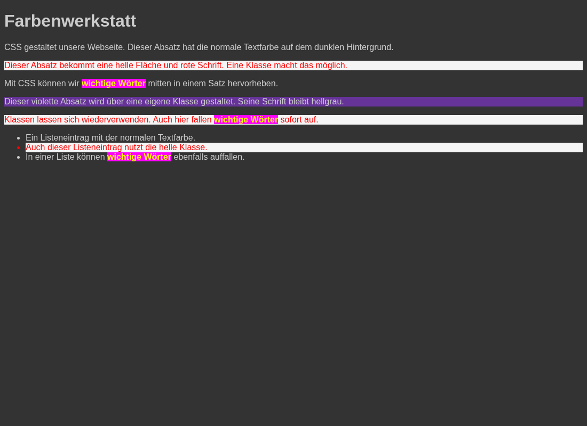

# 1 – Colours and selectors

Style a colour workshop. Practise selecting all elements of one type and highlighting individual parts with reusable classes.

## Your task

1. Create `index.html` and `style.css` in this folder. Generate the HTML boilerplate and link your CSS file inside `<head>` using `<link rel="stylesheet" href="style.css">`.
2. Copy the contents of [texte.txt](texte.txt): one `<h1>` heading and five `<p>` paragraphs. In paragraphs 3 and 5, wrap only the words **wichtige Wörter** in `<strong>`.
3. Style the entire page using the `body` type selector: background `#333333`, text colour `#cccccc`, font family `Arial, sans-serif`.
4. Give paragraphs 2 and 5 the same class, choosing its name yourself: both get red text (`red`) on a light background (`whitesmoke`).
5. Give paragraph 4 a different class and a `rebeccapurple` background. Its text remains light grey.
6. Give both `<strong>` elements the same additional class: yellow text (`yellow`) on a `magenta` background. Only the two words should be highlighted.
7. Below the paragraphs, add a list with the three entries from `texte.txt`. For the second entry, reuse the existing class for red text on a light background. In the third entry, highlight only **wichtige Wörter** using `<strong>` and the existing highlighting class.
8. For the red text in the second paragraph, try `red`, `#ff0000`, and `rgb(255, 0, 0)` in turn. The colour stays the same. You can choose any of these notations for your final result.

## New: colours as codes

Besides colour names, CSS also understands colour codes. For example, these three values represent **the same red colour**:

| Notation | Example |
| --- | --- |
| Colour name | `red` |
| Hex code | `#ff0000` |
| RGB value | `rgb(255, 0, 0)` |

In a six-digit hex code, each pair of characters after the hash represents red, green, and blue respectively. RGB uses three numbers from `0` to `255` for these colour components. You can use these values for `color` and `background-color` just like colour names. `#333333` is dark grey; `#cccccc` is light grey. Here, the hash belongs to the **colour value**, not the selector.

## New: a list

`<ul>` contains a bulleted list. Each entry goes in its own `<li>` element inside the list:

```html
<ul>
    <li>A first entry</li>
    <li>Another entry</li>
</ul>
```

You can also assign a class to an `<li>`. Reuse your existing CSS classes for this exercise.

## Target image



## Done when

- The page contains one heading, five paragraphs, and a list with three entries from the copied texts.
- The colours match the task and target image.
- The existing classes style light paragraphs and list entries, as well as all three highlighted word groups.
- The styling is in the linked `style.css` and uses type and class selectors.
