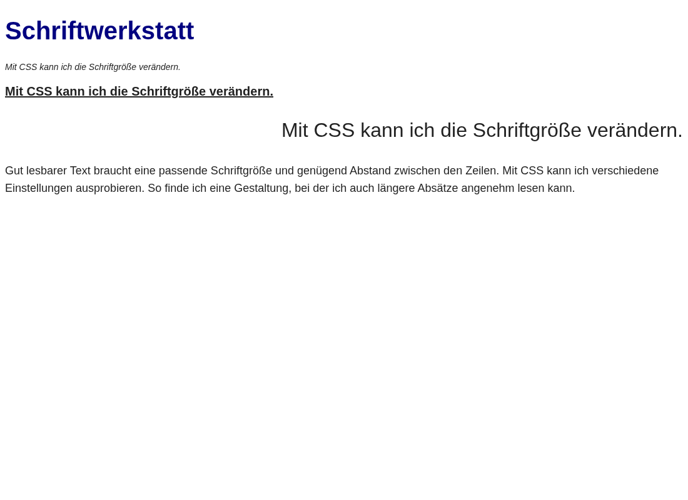

# 2 – Schriftgrößen ausprobieren

Erstelle eine Schriftwerkstatt. Probiere verschiedene Schriftgrößen, Schriftarten und Textformatierungen direkt in deiner CSS-Datei aus.

## Dein Auftrag

1. Erstelle in diesem Ordner eine eigene `index.html` mit Grundgerüst und eine `style.css`. Verknüpfe sie im `<head>` mit `<link rel="stylesheet" href="style.css">`.
2. Kopiere die Texte aus [texte.txt](texte.txt). Verwende eine `<h1>` und vier `
`-Absätze: In den ersten drei steht derselbe Beispielsatz, im vierten der längere Lesetext.
3. Wähle für `body` die Schriftfamilie `Arial, sans-serif` und die Textfarbe `#222222`. Der Hintergrund bleibt weiß.
4. Gestalte die Überschrift mit der Schriftgröße `40px` und der Textfarbe `navy`.
5. Vergib an die vier Absätze unterschiedliche Klassen. Setze zunächst nur die Schriftgrößen: `14px`, `20px`, `32px` und `18px` in dieser Reihenfolge.
6. Führe die Versuche aus der Tabelle unten durch. Ändere jeweils nur eine Eigenschaft, speichere und kontrolliere das Ergebnis im Browser.
7. Stelle anschließend diese Zielwerte für dein Endergebnis ein:

   | Absatz | Schriftgröße | Weitere Formatierung |
   | --- | --- | --- |
   | 1 | `14px` | `font-style: italic` |
   | 2 | `20px` | `font-weight: bold` und `text-decoration: underline` |
   | 3 | `32px` | `text-align: right` |
   | 4 | `18px` | `line-height: 1.6` |

   Setze die übrigen getesteten Formatierungen wieder auf ihre Ausgangswerte zurück. Verwende abschließend überall `Arial, sans-serif` und vergleiche deine Seite mit dem Zielbild.

## Ausprobieren statt nur lesen

| Eigenschaft | Damit veränderst du … | Dein Versuch |
| --- | --- | --- |
| `font-size` | die Schriftgröße; `px` steht für CSS-Pixel | Teste am zweiten Absatz `12px`, `24px` und `48px`. |
| `font-family` | die Schriftfamilie | Teste für die Seite `Georgia, serif` und `"Courier New", monospace`. Die Angabe nach dem Komma ist die Ersatz-Schriftfamilie. |
| `font-weight` | die Schriftstärke | Wechsle am zweiten Absatz zwischen `normal` und `bold`. |
| `font-style` | normale und kursive Schrift | Wechsle am ersten Absatz zwischen `normal` und `italic`. |
| `text-decoration` | Textlinien | Teste am zweiten Absatz `none`, `underline` und `line-through`. |
| `text-align` | die Ausrichtung innerhalb des Textblocks | Teste am dritten Absatz `left`, `center` und `right`. |
| `line-height` | die Zeilenhöhe | Teste am Lesetext `1`, `1.6` und `2.2`. Ohne Einheit ist der Wert ein Faktor der Schriftgröße. |

Verkleinere beim Testen der Zeilenhöhe das Browserfenster, sodass der Lesetext mehrere Zeilen braucht. Lasse den Text automatisch umbrechen.

## Zielbild

## Fertig, wenn

- Eine Überschrift und vier Absätze zeigen die kopierten Texte.
- Die Überschrift hat `40px`; die Absätze entsprechen den Größen und Formatierungen aus der Zieltabelle.
- Schriftfamilie und Farben stimmen mit dem Auftrag überein; die Gestaltung steht in der externen `style.css`.
- Du hast die Varianten aus der Versuchstabelle im Browser ausprobiert und anschließend den Zielzustand in HTML und CSS hergestellt.
