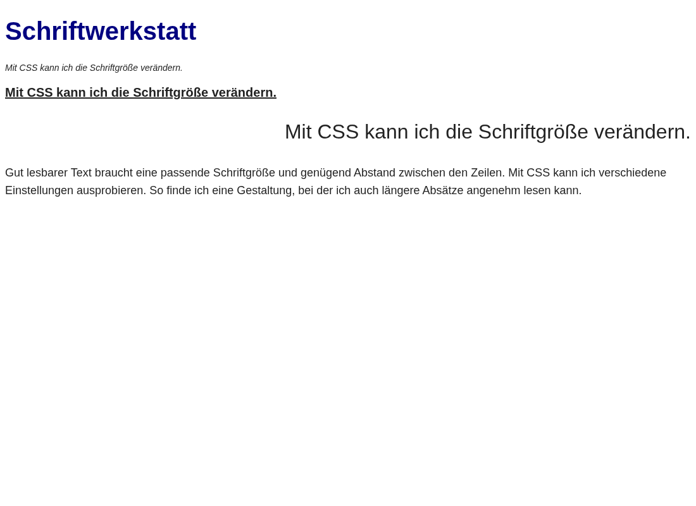

# 2 – Experiment with font sizes

Create a font workshop. Try different font sizes, font families, and text formatting directly in your CSS file.

## Your task

1. Create your own `index.html` with boilerplate and a `style.css` in this folder. Link them inside `<head>` using `<link rel="stylesheet" href="style.css">`.
2. Copy the texts from [texte.txt](texte.txt). Use one `<h1>` and four `
` paragraphs: the first three contain the same example sentence; the fourth contains the longer reading text.
3. Set the `body` font family to `Arial, sans-serif` and the text colour to `#222222`. Keep the background white.
4. Give the heading a font size of `40px` and the text colour `navy`.
5. Give the four paragraphs different classes. Start by setting only the font sizes: `14px`, `20px`, `32px`, and `18px`, in that order.
6. Carry out the experiments in the table below. Change only one property at a time, save, and check the result in the browser.
7. Then set these target values for your final result:

   | Paragraph | Font size | Additional formatting |
   | --- | --- | --- |
   | 1 | `14px` | `font-style: italic` |
   | 2 | `20px` | `font-weight: bold` and `text-decoration: underline` |
   | 3 | `32px` | `text-align: right` |
   | 4 | `18px` | `line-height: 1.6` |

   Restore the other formatting you tested to its original values. Finish with `Arial, sans-serif` throughout and compare your page with the target image.

## Try it instead of just reading

| Property | Changes … | Your experiment |
| --- | --- | --- |
| `font-size` | the text size; `px` stands for CSS pixels | Try `12px`, `24px`, and `48px` on the second paragraph. |
| `font-family` | the font family | Try `Georgia, serif` and `"Courier New", monospace` for the page. The family after the comma is the fallback. |
| `font-weight` | the font weight | Switch the second paragraph between `normal` and `bold`. |
| `font-style` | regular and italic text | Switch the first paragraph between `normal` and `italic`. |
| `text-decoration` | lines on text | Try `none`, `underline`, and `line-through` on the second paragraph. |
| `text-align` | alignment within the text block | Try `left`, `center`, and `right` on the third paragraph. |
| `line-height` | the line height | Try `1`, `1.6`, and `2.2` on the reading text. Without a unit, the value is a multiplier of the font size. |

When testing line height, make the browser window narrow enough for the reading text to span several lines. Let the text wrap automatically.

## Target image

## Done when

- One heading and four paragraphs display the copied texts.
- The heading is `40px`; the paragraphs match the sizes and formatting in the target table.
- Font family and colours match the task; styling is in the external `style.css`.
- You have tried the variants from the experiment table in the browser and then created the target state in HTML and CSS.
