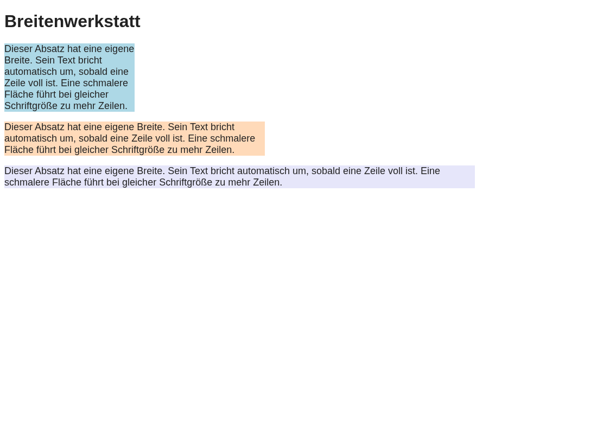

# 3 – Textbreiten entdecken

Baue eine Breitenwerkstatt mit drei Textabsätzen. Mit der neuen Eigenschaft `width` vergleichst du feste und prozentuale Breiten.

## Dein Auftrag

1. Erstelle in diesem Ordner selbst eine `index.html` mit Grundgerüst und eine `style.css`. Verbinde sie im `<head>` mit `<link rel="stylesheet" href="style.css">`.
2. Kopiere die Überschrift und den Text aus [texte.txt](texte.txt). Verwende eine `<h1>` und drei `<p>`-Absätze direkt im `<body>`. Jeder Absatz enthält denselben Text.
3. Nutze für `body` die Schriftfamilie `Arial, sans-serif` und die Textfarbe `#222222`. Der Hintergrund bleibt weiß. Alle Absätze bekommen dieselbe Schriftgröße: `18px`.
4. Vergib drei unterschiedliche Klassen. Gestalte die Absätze in dieser Reihenfolge:

   | Absatz | Breite | Hintergrundfarbe |
   | --- | --- | --- |
   | 1 | `240px` | `lightblue` |
   | 2 | `480px` | `peachpuff` |
   | 3 | `80%` | `lavender` |

5. Ziehe das Browserfenster breiter und schmaler und vergleiche die farbigen Flächen und Zeilenumbrüche. Verändere dabei die Schriftgröße nicht.
6. Ändere die Breite des ersten Absatzes testweise auf `360px`. Setze beim dritten Absatz nacheinander `50%` und `100%` und verändere jeweils die Fensterbreite.
7. Stelle für dein Endergebnis wieder alle Breiten aus der Tabelle her. Deine HTML-/CSS-Seite soll dem Zielbild entsprechen.

## Neu: `width`

`width` bestimmt die Breite eines Elements. Die Hintergrundfarbe macht diese Breite sichtbar:

```css
.beispiel {
    width: 360px;
    background-color: lightgreen;
}
```

- **Pixel**, zum Beispiel `360px`: eine feste Breite in CSS-Pixeln. Sie verändert sich beim Verändern der Fensterbreite nicht. Ist das Fenster zu schmal, kann der Absatz seitlich überstehen.
- **Prozent**, zum Beispiel `60%`: beziehen sich hier auf die verfügbare Inhaltsbreite des Elternelements. Deine Absätze liegen direkt in `body`. Wenn dieser Bereich breiter oder schmaler wird, verändert sich auch die Prozentbreite.

`width` verändert weder die Schriftgröße noch den Textinhalt. Text bricht automatisch um; ein schmalerer Absatz braucht für denselben Text meistens mehr Zeilen. Füge keine manuellen Zeilenumbrüche ein und lege keine feste Höhe fest.

## Zielbild



## Fertig, wenn

- Eine Überschrift und drei Absätze zeigen die kopierten Texte.
- Alle Absätze haben `18px` Schriftgröße; Breiten und Farben stimmen mit der Tabelle überein.
- Der Text bricht automatisch um und die Gestaltung steht in der externen `style.css`.
- Du hast die zusätzlichen Breiten ausprobiert und für das Endergebnis die Werte aus der Tabelle wiederhergestellt.
