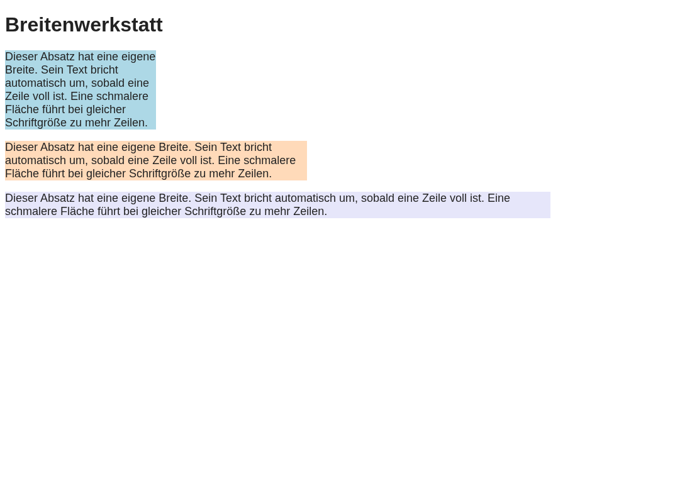

# 3 – Discover text widths

Build a width workshop with three text paragraphs. Use the new `width` property to compare fixed and percentage widths.

## Your task

1. Create your own `index.html` with boilerplate and a `style.css` in this folder. Connect them inside `<head>` using `<link rel="stylesheet" href="style.css">`.
2. Copy the heading and text from [texte.txt](texte.txt). Use one `<h1>` and three `<p>` paragraphs directly inside `<body>`. Each paragraph contains the same text.
3. Set the `body` font family to `Arial, sans-serif` and the text colour to `#222222`. Keep the background white. All paragraphs get the same font size: `18px`.
4. Assign three different classes. Style the paragraphs in this order:

   | Paragraph | Width | Background colour |
   | --- | --- | --- |
   | 1 | `240px` | `lightblue` |
   | 2 | `480px` | `peachpuff` |
   | 3 | `80%` | `lavender` |

5. Make the browser window wider and narrower, and compare the coloured areas and line breaks. Keep the font size unchanged.
6. Temporarily change the first paragraph's width to `360px`. For the third paragraph, try `50%` and `100%` in turn, changing the window width each time.
7. Restore all widths from the table for your final result. Your HTML/CSS page should match the target image.

## New: `width`

`width` determines an element's width. The background colour makes this width visible:

```css
.example {
    width: 360px;
    background-color: lightgreen;
}
```

- **Pixels**, for example `360px`: a fixed width in CSS pixels. It does not change when the window width changes. If the window is too narrow, the paragraph can extend beyond its edge.
- **Percentages**, for example `60%`: here, these refer to the available content width of the parent element. Your paragraphs are directly inside `body`. When this area becomes wider or narrower, the percentage width changes too.

`width` changes neither the font size nor the text content. Text wraps automatically; a narrower paragraph usually needs more lines for the same text. Do not insert manual line breaks or set a fixed height.

## Target image



## Done when

- One heading and three paragraphs display the copied texts.
- All paragraphs have an `18px` font size; widths and colours match the table.
- Text wraps automatically and styling is in the external `style.css`.
- You have tried the additional widths and restored the table's values for the final result.
